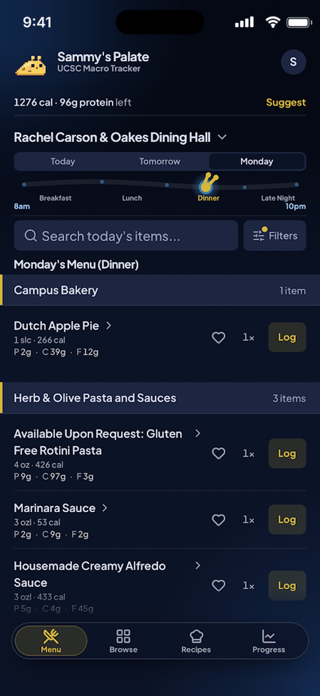
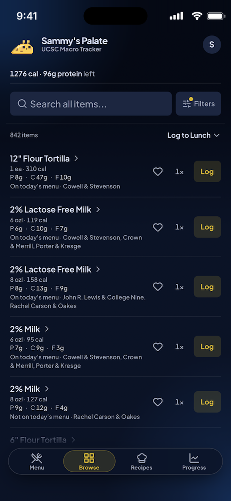
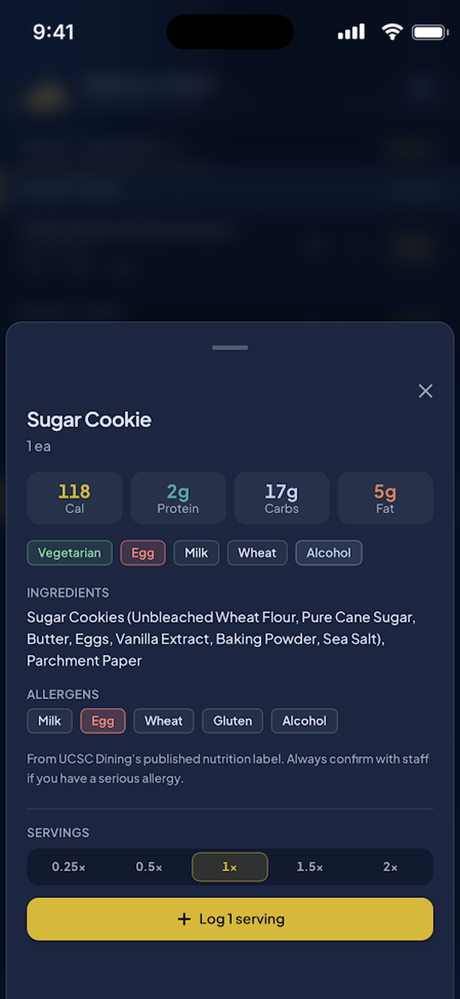
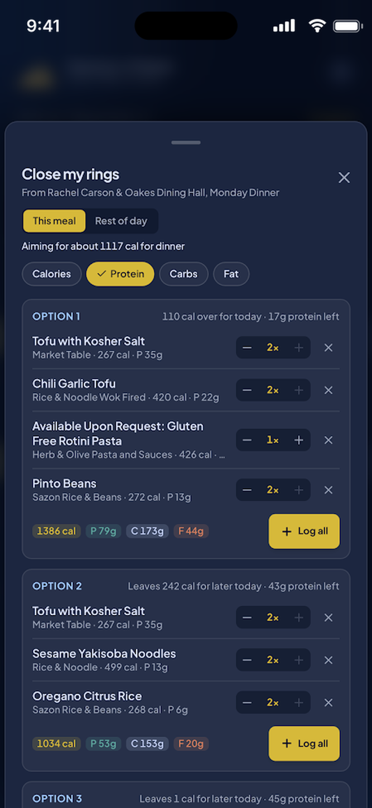
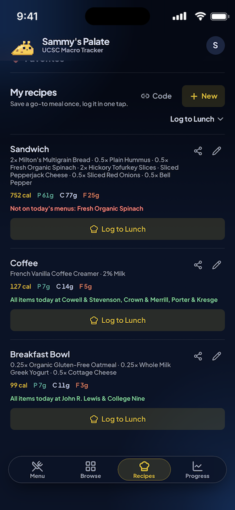
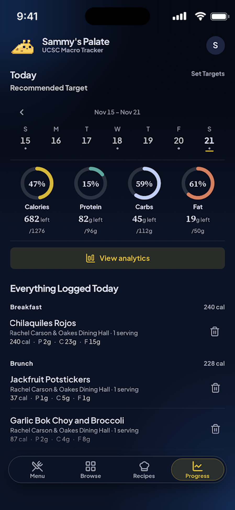
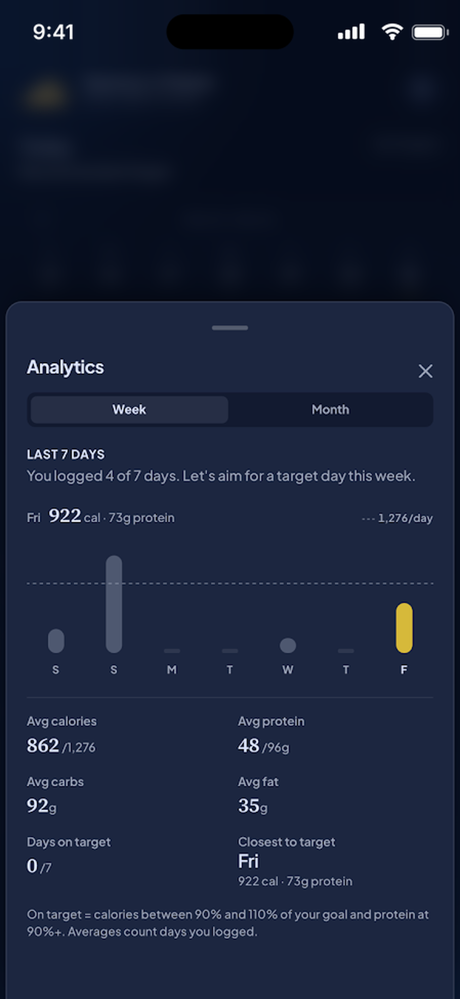
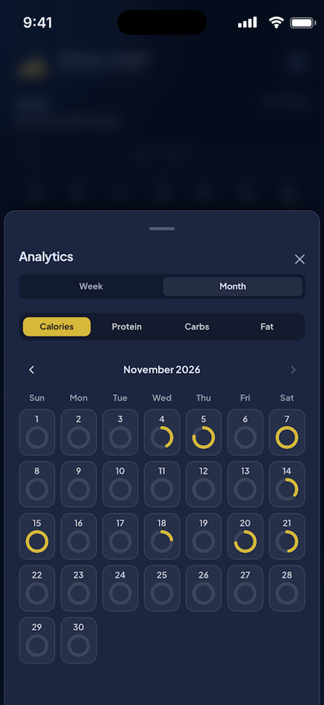
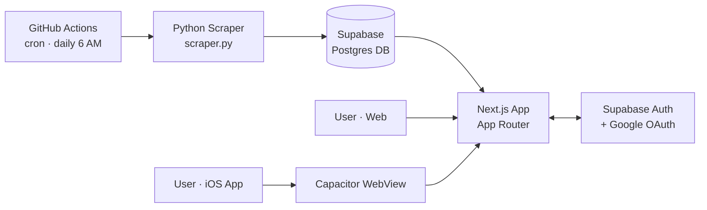

# Sammy's Palate: UCSC Macro Tracker

A macro and nutrition tracker built specifically for UC Santa Cruz dining halls, cafes, and markets. Browse today's menu, check ingredients and allergens, log what you eat in a couple of taps, and watch your calories, protein, carbs, and fat update in real time.

[](https://ucsc-dining-tracker.vercel.app)
[](https://apps.apple.com/app/sammys-palate/id6806954658)


**[🔗 Live Demo](https://ucsc-dining-tracker.vercel.app/)**: sign up and try it out. Also **[available on the App Store](https://apps.apple.com/app/sammys-palate/id6806954658)** for iPhone.

**80+** downloads · **233K+** menu records indexed across **14** dining halls · **470+** scraper runs at 100% success · **90+** days of history stored · **64** iOS builds / **4** App Store releases shipped via CI/CD

---

## Table of Contents
- [Why I Built This](#why-i-built-this)
- [Screenshots](#screenshots)
- [Features](#features)
- [Tech Stack](#tech-stack)
- [Architecture](#architecture)
- [Getting Started](#getting-started)
- [Usage](#usage)
- [Roadmap](#roadmap)
- [License](#license)

## Why I Built This

UCSC's official dining hall nutrition calculator technically has the data I need, but using it is a pain: the interface makes it slow to find items, there's no way to search or filter by station, and, most importantly, **it doesn't save anything**. Every day starts from zero, with no history of what you've eaten or how close you are to your goals.

Sammy's Palate solves that. Every morning at 6 AM, a scraper pulls the current menu for all 5 UCSC dining halls and 9 cafes and markets. The app turns that data into a fast, searchable menu you can log meals from in seconds, with your daily macro totals, progress rings, weekly analytics, and history saved automatically. It's also shipped as a native iOS app.

## Screenshots

<table>
<tr>
<td align="center" width="25%"><br/><sub>Today's menu by dining hall, meal, and station</sub></td>
<td align="center" width="25%"><br/><sub>Search every item on campus</sub></td>
<td align="center" width="25%"><br/><sub>Ingredients, allergens, and diet tags for any item</sub></td>
<td align="center" width="25%"><br/><sub>Meal combos that fit the macros you have left</sub></td>
</tr>
<tr>
<td align="center" width="25%"><br/><sub>Save go-to meals and log them in one tap</sub></td>
<td align="center" width="25%"><br/><sub>Rings show what's left today, with a week strip</sub></td>
<td align="center" width="25%"><br/><sub>Weekly averages and your closest-to-target day</sub></td>
<td align="center" width="25%"><br/><sub>Month calendar of rings by calories, protein, carbs, or fat</sub></td>
</tr>
</table>

## Features

**Menu & browsing**
- Live menus for all 5 dining halls and 9 cafes and markets, pulled daily
- Browse today, tomorrow, and the day after
- Interactive day track: drag the marker through the dining day or tap a meal period to preview its menu
- Filter by meal period and by station (Entrees, Grill, Hot Bars, Soups, Cereal, Condiments, and more), with favorites
- Free-text search across today's items, plus a Browse tab to search every item on campus
- Instant open/closed status per dining hall, computed from published hours with no scraping delay

**Ingredients & allergens**
- Tap any item to see its real ingredient list, allergens, and dietary icons from UCSC Dining
- Choose a diet type (vegetarian or vegan) and mark allergens to avoid (milk, egg, wheat, gluten, soy, sesame, peanut, tree nut, fish, shellfish)
- The menu shows only items that fit your diet and hides items containing your allergens

**Logging & tracking**
- One-tap logging with adjustable serving size (¼x–2x) and a choice of meal
- Real-time totals for calories, protein, carbs, and fat
- Delete a logged item with a tap-to-confirm button, and undo it with a toast

**Close my rings & recipes**
- Close my rings builds meal combos from the menu that fit your remaining calories and macros, for this meal or the rest of the day
- Save recipes from your favorite items, log them in one tap, and see whether everything in a recipe is on today's menu
- Share a recipe with a code or link

**Progress & analytics**
- Recommended daily targets calculated from age, biological sex, height, weight, and goal (lose/maintain/gain), or set targets manually
- Ring-based progress for each macro, showing how much is left, updated live as you log
- A week strip you can slide back through time to review any past day
- Analytics sheet with a Week view (average calories, protein, carbs, and fat, days on target, and the day closest to your target) and a Month calendar by metric
- Hold a bar in the weekly chart to see that day's macro split
- Guided onboarding after signup to set initial targets

**Account & settings**
- Email/password sign-up with a forgot-password flow, and Google Sign-In
- Editable profile: nickname and avatar (camera or photo library upload)
- Dietary preferences, text size, and a toggle for mascot animations
- Account deletion

**Design & accessibility**
- Dark interface with serif numerals and a shifting blue gradient background
- Respects iOS Reduce Motion and Reduce Transparency, adjustable text size, and 44px tap targets
- Haptic feedback on the native app

**Native iOS App**
- Live on the App Store, built with Capacitor and shipped through Codemagic CI/CD
- Deep-link handling for OAuth and password reset

## Tech Stack

| Layer | Technology |
|---|---|
| Frontend | Next.js 16 (App Router), React 19, TypeScript, Tailwind CSS v4 |
| Auth & Database | Supabase (Postgres + Auth, Google OAuth, row level security) |
| Scraper | Python: Playwright (dynamic page rendering), BeautifulSoup (HTML parsing), python-dotenv, supabase-py |
| Automation | GitHub Actions (scheduled cron: daily menu scrape, upcoming days, and frequent hall status updates) |
| Native App | Capacitor (iOS), Codemagic (CI/CD) |
| Hosting | Vercel |
| Linting | ESLint |

## Architecture



Every morning, a scheduled GitHub Action runs `scraper.py`, which pulls the day's menu for every dining hall, cafe, and market and writes it to Supabase. Other workflows scrape upcoming days and keep hall open/closed status current. The Next.js app reads menu data from Supabase at request time and handles auth, food logging, recipes, and progress tracking through the same database. The iOS app is a Capacitor-wrapped shell that loads the same live web app, so UI updates reach iPhones without a new App Store release.

## Getting Started

### Prerequisites
- Node.js 18+
- Python 3.10+
- A Supabase project (free tier is fine)

### 1. Clone the repo
```bash
git clone https://github.com/kunjalp/ucsc_dining_tracker.git
cd ucsc_dining_tracker
```

### 2. Set up the database
Run the numbered SQL files in `web-app/supabase/migrations/` in order in the Supabase SQL Editor. See the README in that folder for details. `001` and `002` are one-time setup only and destroy data if rerun, so don't run them on a database that already has data.

### 3. Set up the web app
```bash
cd web-app
npm install
```

Create a `.env.local` file in `web-app/` with:
```bash
NEXT_PUBLIC_SUPABASE_URL=your-supabase-project-url
NEXT_PUBLIC_SUPABASE_ANON_KEY=your-supabase-anon-key
```

Run the dev server:
```bash
npm run dev
```
The app will be available at `http://localhost:3000`.

### 4. Set up the scraper
```bash
cd ../scraper
pip install -r requirements.txt
playwright install chromium
python scraper.py
```
The scraper writes directly to your Supabase database, so make sure your Supabase credentials are configured for it as well (see `.github/workflows/` for how this runs in production).

## Usage

1. Sign up or sign in with email or Google, then set your diet, allergens, and daily targets.
2. On **Menu**, pick a dining hall and meal period, then search or filter by station to find what you're eating. Use **Browse** to search every item on campus.
3. Tap an item's name for its ingredients and allergens. Adjust the serving size and tap **Log**.
4. Switch to **Progress** to see what's left against your daily targets, slide the week strip to review past days, or tap **View analytics** for weekly averages and the month calendar.
5. Not sure what to eat? Tap **Suggest** or **Close my rings** on the Menu tab for combos that fit your remaining macros.
6. Save meals you eat often in **Recipes** and log them in one tap.

## Roadmap

- [x] Macro suggestions: meal combos that hit a target (Close my rings)
- [x] Weekly and monthly analytics
- [ ] Automated backend unit tests for the scraper's parsing logic
- [ ] Meal history export
- [ ] Push/email reminders to log meals

## License

This project is licensed under the [MIT License](LICENSE).

---

Built by [Kunjal Purohit](https://github.com/kunjalp). UCSC's official nutrition calculator is a pain to use, so I built my own.
